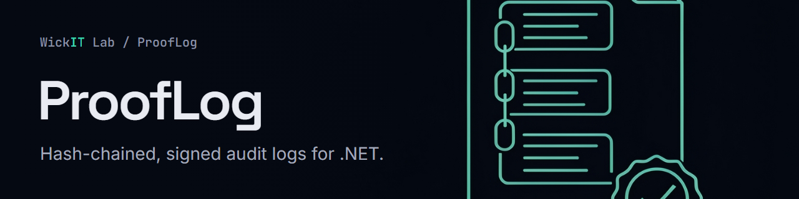
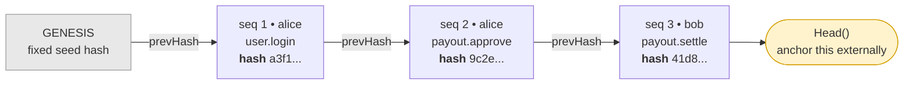
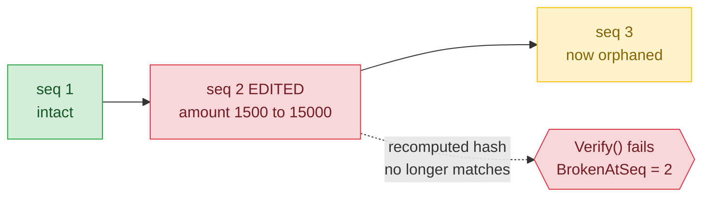
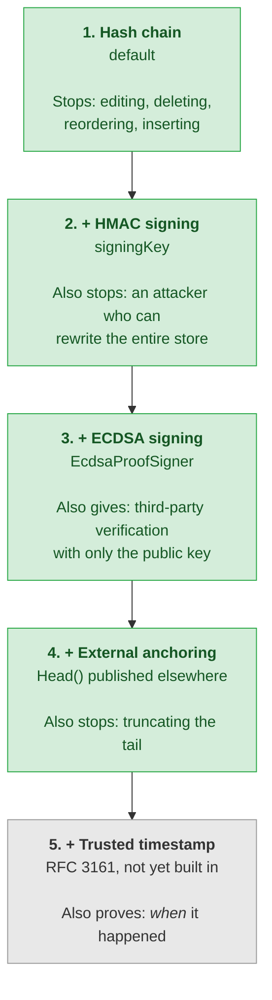

<p align="center">
  
</p>

**A tamper-evident, identity-bound audit log and a verifiable digital chain-of-custody for .NET**

ProofLog is hash-chained, queryable, evidence-grade logging for systems that must prove who did what, and when, to an auditor, a regulator or a court. The same properties that satisfy record-keeping regulations (CRA, DORA, NIS2, EU AI Act) also make it a chain-of-custody layer for digital evidence: every record is append-only, identity-bound, time-stamped, hash-chained and optionally signed, so an independent party can verify it with only the public key, without being able to forge it. SQLite-backed, with a one-call, self-verifying evidence export.

Built as a .NET 8 library (C#) on SQLite, published to NuGet as [`ProofLog`](https://www.nuget.org/packages/ProofLog/) (current version 0.4.1). It runs in-process inside your own app: no service, no network calls, no telemetry. It is the open-source core of the CRADesk compliance line and the tamper-evident evidence store inside the commercial CRADesk dossier engine.

> **Scope of the guarantee.** ProofLog proves integrity and order: that records were not altered, reordered or forged after the fact, verifiable by a third party with only the public key. It does **not** by itself prove *when* an event happened: timestamps come from the host clock, so an operator with write access could set the clock and build a self-consistent chain at any time. For an independent time guarantee, anchor the chain to a trusted timestamp authority (RFC 3161) or a public ledger. "Chain-of-custody evidence" here means integrity-grade, not a standalone claim of court admissibility, which depends on jurisdiction, process and trusted time.

## Contents

- [Tech stack](#tech-stack)
- [Prerequisites](#prerequisites)
- [Getting started](#getting-started)
- [Features (built)](#features-built)
- [Why](#why)
- [How it works](#how-it-works)
- [Use it in an app](#use-it-in-an-app)
- [Signing](#signing)
- [Evidence export](#evidence-export)
- [API](#api)
- [Assurance ladder](#assurance-ladder)
- [Security](#security)
- [What's not yet built](#whats-not-yet-built)
- [License](#license)

## Tech stack

| Layer | Technology |
| --- | --- |
| Library | .NET 8 (C#); depends on Microsoft.Data.Sqlite plus the Microsoft.Extensions dependency-injection and logging abstractions |
| Store | SQLite (durable) or in-memory |
| Crypto | SHA-256 hash chain; HMAC-SHA256 or ECDSA P-256 signing (.NET BCL, no extra dependency) |
| Tests and samples | xUnit (49 tests, including tamper and forgery scenarios); two demo apps on .NET 10 |
| Release | GitHub Actions, published to NuGet with Trusted Publishing on each `v*` tag, so no long-lived API key exists for this repository |

## Prerequisites

- To use the package: a project targeting .NET 8 or later
- To build from source, run the tests or run the samples: the .NET 10 SDK (the library targets .NET 8; the tests and demos target .NET 10)

## Getting started

1. Add the package:

   ```bash
   dotnet add package ProofLog
   ```

2. Append, verify and export:

   ```csharp
   using ProofLog;

   // Durable, file-backed log (or InMemoryProofLog for tests / embedding).
   using var log = new SqliteProofLog("audit.db");

   log.Append(new AuditEntry { Actor = "alice", Action = "user.login", Resource = "session/abc" });
   log.Append(new AuditEntry { Actor = "alice", Action = "payout.approve", Resource = "payout/42", Data = "{\"amount\":1500}" });

   // Verify the whole chain - O(n), no external service.
   VerificationResult v = log.Verify();
   Console.WriteLine(v.Ok ? "intact" : $"TAMPERED at #{v.BrokenAtSeq}: {v.Reason}");

   // One-call, self-verifying evidence export for an auditor.
   File.WriteAllText("evidence.json", Evidence.ToJson(log));
   ```

3. Or try it from a clone, with no install:

   ```bash
   git clone https://github.com/wickitlab/ProofLog.git
   cd ProofLog
   dotnet run --project samples/ProofLog.Demo
   ```

   The demo appends a chain, verifies it, then rewrites a record directly in the database and watches verification fail at exactly that record.

4. For a worked use case, run the settlement-evidence demo:

   ```bash
   dotnet run --project samples/ProofSettle.Demo
   ```

   It records signed settlement evidence for a few mock prediction markets, exports an MGA-profiled bundle that a regulator or player verifies with only the public key, then flips one market in the raw database and watches independent verification catch it. That is the independent proof an operator's own, mutable logs cannot give.

5. Build and run the tests:

   ```bash
   dotnet build -c Release
   dotnet test -c Release
   ```

## Features (built)

### Log and verification

- Append-only, identity-bound records: an entry without an actor and an action is rejected
- SHA-256 hash chain with length-prefixed fields, chained from a fixed genesis hash
- `Verify()` replays the whole chain and reports the exact sequence number and reason of the first break
- `Head()` and `Verify(expectedHead)` for anchoring the chain head externally, which also detects truncation
- SQLite store (`SqliteProofLog`) and a non-durable in-memory store (`InMemoryProofLog`)

### Signing

- Optional HMAC-SHA256 signing, which defeats a full-chain rewrite by someone without the key
- Optional asymmetric ECDSA P-256 signing (`EcdsaProofSigner`): hand an auditor the public key and they can verify without being able to forge
- Unsigned logs stay fully supported

### Evidence export

- One-call, self-verifying JSON evidence bundle (`Evidence.ToJson`)
- Named regulator profiles: CRA, DORA, NIS2, EU AI Act, MGA gaming and a digital-evidence chain-of-custody profile (ISO/IEC 27037 and 27043)

### Adoption helpers

- `AddProofLog(...)` dependency-injection registration for ASP.NET Core and worker apps
- `logger.Audit(...)` records to ProofLog and emits through your existing `ILogger` in one call

Release history is in [CHANGELOG.md](CHANGELOG.md).

## Why

Ordinary logs are editable. If an attacker or an insider can change history, your logs cannot prove anything to a regulator or a court. ProofLog makes every record cryptographically chained to the one before it: change, delete, reorder or insert a single entry and verification fails at exactly that point. Each record is also identity-bound - the actor is part of the chain, so you cannot later rewrite who did something.

## How it works

Every record carries the hash of the record before it, so the log is a chain rather than a list. Each link commits to everything behind it.



Each record's hash is:

```
hash_i = SHA-256( hash_{i-1}  ||  seq  ||  timestamp  ||  actor  ||  action  ||  resource  ||  data )
```

Fields are length-prefixed before hashing, so no value can be crafted to forge an equivalent encoding. The first record chains from a fixed genesis hash. `Verify()` walks the log, recomputes every hash from the stored fields, and checks each record's `PrevHash` against the actual previous hash and that sequence numbers are contiguous.

Because record 3 commits to record 2, which commits to record 1, altering anything in the middle invalidates every link after it. Verification reports the exact sequence number where the break occurs:



| Tampering | Detected by |
| --- | --- |
| Edit a field (actor, action, data, time) | content hash mismatch |
| Overwrite a stored hash | content hash mismatch |
| Delete a record | sequence break + prev-hash mismatch |
| Insert or reorder records | sequence break + prev-hash mismatch |
| **Truncate the tail** | anchor `Head()` externally, see below |

### A note on truncation

Deleting records from the end leaves a chain that is still internally consistent. That is a fundamental property of hash chains, not a bug. `Head()` returns the current chain-head hash; anchor it somewhere the attacker cannot reach (publish it, notarize it, send it to a second system), then verify against it:

```csharp
var anchored = log.Verify(savedHead);   // checks the chain AND that the head matches
```

If records were truncated (or appended) since `savedHead` was recorded, the heads will not match and verification fails. ProofLog is honest about this rather than pretending a local-only log can detect its own truncation.

## Use it in an app

```csharp
// DI (ASP.NET Core / worker) - one line:
builder.Services.AddProofLog("audit.db");      // optional signingKey: key

// inject IProofLog anywhere and append, no ceremony:
log.Append("alice", "payout.approve", "payout/42", "{\"amt\":1500}");

// or record AND emit through your existing ILogger in one call -
// observability and tamper-evident evidence together:
logger.Audit(log, "alice", "payout.approve", "payout/42");
```

## Signing

Signing is optional and recommended for high assurance. A bare hash chain has one gap: an attacker with full write access to the store can rewrite the whole chain, recomputing every hash, and `Verify()` passes (the hashes are public, so anyone can recompute them). Pass a signing key and that stops working: each record also carries an HMAC-SHA-256 over its hash, and verification fails unless the record was produced with the key.

```csharp
byte[] key = /* from a secret store / KMS, NOT in code */;
using var log = new SqliteProofLog("audit.db", signingKey: key);
log.Append(new AuditEntry { Actor = "alice", Action = "payout.approve" });
log.Verify();   // also checks every record's MAC
```

An attacker who can rewrite the database but does not have the key cannot forge a valid record. Keep the key out of the same trust boundary as the log (a KMS, an HSM, a separate service). Unsigned logs are unchanged and fully supported.

### Asymmetric signing

HMAC has one limitation for evidence you hand to a third party: the same key signs and verifies, so whoever can verify can also forge. For a dossier given to a regulator you want the opposite: they should be able to verify without being able to forge. Pass an `EcdsaProofSigner` (NIST P-256, built on the .NET BCL, no extra dependency): you keep the private key, and the auditor verifies with only the public key.

```csharp
using var signer = EcdsaProofSigner.Create();      // or FromPrivateKey(base64) from your vault
string publicKey = signer.ExportPublicKey();        // publish this with the evidence

using (var log = new SqliteProofLog("audit.db", signer))
    log.Append(new AuditEntry { Actor = "alice", Action = "payout.approve" });

// The auditor, holding ONLY the public key, can verify but not append or forge:
using var auditor = EcdsaProofSigner.FromPublicKey(publicKey);
using var check = new SqliteProofLog("audit.db", auditor);
check.Verify();          // true - the chain was produced by the private key
check.Append(/* ... */); // throws: a verify-only (public) key cannot extend the trail
```

Same `Verify()`, same `Mac` column; the signature is just public-key now. `AddProofLog(path, signer)` wires it through DI.

## Evidence export

`Evidence.ToJson(log)` produces a portable bundle: every record plus the head hash and a fresh verification statement. An auditor needs nothing but that file and the public hashing rule above to independently replay the chain and confirm it.

### Regulator profiles

Tag the export with a named profile so the bundle states which obligation it speaks to and maps that obligation onto ProofLog's properties:

```csharp
string json = Evidence.ToJson(log, RegulatorProfiles.Cra);   // or "dora", "nis2", "eu-ai-act", "mga-gaming", "digital-evidence"
```

| Key | Framework | Obligation it addresses |
| --- | --- | --- |
| `cra` | EU Cyber Resilience Act | Vulnerability handling + technical documentation (Annex I Part II, Art. 13/14) |
| `dora` | EU DORA | ICT incident management + auditable records (Art. 17-19) |
| `nis2` | EU NIS2 Directive | Risk-management measures incl. logging + incident reporting (Art. 21/23) |
| `eu-ai-act` | EU AI Act | Automatic record-keeping / traceability for high-risk AI (Art. 12/19) |
| `mga-gaming` | Malta Gaming Authority | Gaming-transaction record-keeping + evidencing how a contested / voided market resolved |
| `digital-evidence` | ISO/IEC 27037 + 27043 | Digital-evidence chain of custody: documented custody, provable integrity, authenticated origin, independent verifiability |

The profiled bundle adds the framework, the regulation reference, the requirement-to-property mapping, a `signed` flag, and a standing disclaimer (it documents log integrity, not compliance, and is not legal advice).

### Digital evidence and chain of custody

The `digital-evidence` profile is the forensic framing of the same engine. Courts and investigators judge digital evidence on four things, and each maps directly onto a ProofLog property: documented custody (append-only, identity-bound records), provable integrity (the hash chain catches any post-collection alteration), authenticated origin (an ECDSA signature ties the trail to a key the collector controls), and independent verifiability (the public canonicalization rule and public key let a court or opposing expert replay and verify without trusting the holder). Bind an artifact's hash into a record at the moment of collection and the trail becomes the artifact's chain of custody, mapped to ISO/IEC 27037 (collection, acquisition, preservation) and 27043 (the investigation process).

## API

| Type | Purpose |
| --- | --- |
| `IProofLog` | `Append`, `Read`, `Head`, `Count`, `Verify` |
| `SqliteProofLog` | durable SQLite-backed store |
| `InMemoryProofLog` | non-durable store for tests / embedding |
| `AuditEntry` | what you append (actor + action required) |
| `ProofRecord` | a committed, chained record |
| `Evidence` | one-call JSON evidence export, plain or profiled |
| `RegulatorProfiles` | named CRA / DORA / NIS2 / EU AI Act / MGA gaming / digital-evidence export profiles |
| `Hashing` | the canonicalization + SHA-256 rule (so anyone can re-verify) |
| `IProofSigner` | record signing: `HmacProofSigner` (symmetric) or `EcdsaProofSigner` (asymmetric, auditor-verifiable) |

More detail is in [ARCHITECTURE.md](ARCHITECTURE.md) and [HOW_IT_WORKS.md](HOW_IT_WORKS.md).

## Assurance ladder

Each rung defends against a strictly stronger attacker. Pick the lowest one that covers your threat model; every rung is fully supported.



| Rung | Defends against | Cost |
| --- | --- | --- |
| 1. Hash chain (default) | anyone editing, deleting, reordering or inserting records | none |
| 2. HMAC signing | an attacker with full write access rewriting the whole chain | manage one secret key |
| 3. ECDSA signing | the same, and lets an auditor verify without any secret | manage a private key, publish the public one |
| 4. Anchor `Head()` externally | truncation of the tail (a hash chain cannot self-detect this) | somewhere to publish the head |
| 5. Trusted timestamp (RFC 3161) | backdating by an operator who controls the host clock | not built in yet, see the scope note above |

## Security

Report vulnerabilities privately through GitHub's private vulnerability reporting (the repository's Security tab, then Report a vulnerability); do not open a public issue. Cryptographic soundness reports are especially welcome: anything that could let a forged or altered record pass `Verify()`. See [SECURITY.md](SECURITY.md) for scope and response times.

**Known advisory (transitive).** Via `Microsoft.Data.Sqlite` this package pulls `SQLitePCLRaw.*.e_sqlite3`, covered by CVE-2025-6965 (a SQLite memory-corruption bug fixed in SQLite 3.50.2). As of 2026-07 no patched SQLitePCLRaw release existed on the referenced line. ProofLog is not affected in normal use: it executes only its own fixed-schema, parameterized queries and never runs caller- or attacker-supplied SQL, so the vulnerable aggregate-query path is not reachable. The dependency will be bumped when SQLitePCLRaw ships the SQLite 3.50.2 fix; re-checking this is on the [roadmap](ROADMAP.md).

Keep signing keys out of the same trust boundary as the log, and never put them in code.

## What's not yet built

- RFC 3161 trusted timestamp anchoring, so the chain can prove when events happened (planned; today the host clock is trusted)
- Public ledger anchoring as an alternative to RFC 3161
- A CLI for ad-hoc chain verification outside of a .NET host
- An OpenTelemetry bridge, additional stores and a Rust core
- An `EvidenceVault` layer that binds artifact hashes and trusted timestamps into a per-case custody chain
- Published benchmarks for append and verify at scale

See [ROADMAP.md](ROADMAP.md) for the order. Version history, including what v0.1 to v0.4 each added, is in [CHANGELOG.md](CHANGELOG.md).

## License

This project is licensed under:

- [Apache 2.0](LICENSE) - permissive on purpose. ProofLog is meant to be adopted.
